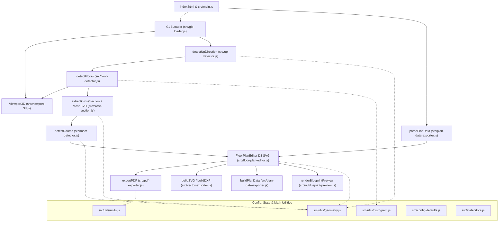

# Architectural Specification — Bay Scallop FloorPlan Extractor

This document specifies the software architecture, module structure, core geometric/3D algorithms, and testing architecture of the FloorPlan Extractor application.

---

## System Architecture

The application is a 100% client-side 4-step wizard (`Load` → `Orient` → `Edit` → `Export`) orchestrated by `src/main.js`, backed by persistent browser storage (`src/state/store.js`) and centralized configuration (`src/config/defaults.js`).

---

## File and Module Structure

- **`index.html` & `index.css`**: Host layout for the 4-step wizard, toolbars, multi-floor tabs, rooms drawer, blueprint preview, Command Palette (`Ctrl+K`), Help/Shortcuts modal (`?`), Settings modal (`,`), and Scale Calibration modal.
- **`src/main.js`**: Application coordinator managing multi-floor state (`state.floorPlans`), wizard navigation, file/sample/JSON loading, cached lazy dynamic `import()` of heavy modules (`glb-loader.js`, `viewport-3d.js`, `cross-section.js`, `pdf-exporter.js`), rAF-throttled undoable slice scrubbing, calibration modal, and exports.
- **`src/config/defaults.js`**: Default settings (`DEFAULT_SETTINGS`), grouped settings metadata (`SETTING_GROUPS`), and keyboard shortcut definitions (`SHORTCUT_GROUPS`).
- **`src/state/store.js`**: `localStorage` persistence for settings (`scallop_settings_v1`) and multi-floor recent scan snapshots (`scallop_recent_items_v1`), safe in headless Node tests.
- **`src/glb-loader.js`**: Multi-format 3D loader (`GLBLoader` / `ModelLoader`) supporting `.glb`, `.gltf`, `.obj`, `.stl`, and meshed `.ply` files via Three.js addons (`GLTFLoader`, `OBJLoader`, `STLLoader`, `PLYLoader`), extracting world-space vertex positions, normals, indices, and bounding boxes (and rejecting face-less point clouds with a clear diagnostic).
- **`src/viewport-3d.js`**: Three.js WebGL renderer with `OrbitControls`, up-direction arrow helper, and model-sized translucent 3D floor slice planes (`showFloorPlanes`, `setFloorPlanesVisible`).
- **`src/up-detector.js`**: Normal-voting (`dot > 0.85`) and bounding-box aspect-ratio heuristic to identify the model's upward axis (`±X`, `±Y`, `±Z`).
- **`src/floor-detector.js`**: Multi-story floor/ceiling histogram peak detector (`detectFloors`, plus single-floor `detectFloor`).
- **`src/cross-section.js`**: Slices 3D triangle meshes at a given height using `three-mesh-bvh` (`MeshBVH`) for meshes with `>= 2,000` triangles and optional Douglas-Peucker wall simplification.
- **`src/room-detector.js`**: Extracts closed room polygons (`detectRooms`) with area classification and smart outer-shell enclosure filtering.
- **`src/floor-plan-editor.js`**: D3.js SVG 2D CAD canvas supporting non-destructive `scanWalls` vs. `draftedWalls` layers with visibility toggles, draggable wall endpoint handles, continuous polyline drawing, Select/Marquee, Pan (`Space+Drag`), Door, Window, Archway, Stairs, Measure, Calibrate, Text, Erase/Marquee Erase, endpoint/midpoint/grid snapping, room overlays, transforms (`autoStraighten`, `rotatePlan`, `flipPlan`, `scalePlan`), properties inspector API (`onSelectionChanged`), and per-floor 50-step Undo/Redo.
- **`src/pdf-exporter.js`**: Multi-page Landscape/Portrait architectural blueprint PDF generator (`jsPDF`) supporting US Imperial architectural scales (`1:24`, `1:48`, `1:96`) and Metric scales, exact unit-accurate graphic scale bars (`computeScaleBar`), room fills/labels, on-sheet Room Schedule table, rotatable North Arrow, door/window symbols, dimensions, and editable Title Block metadata.
- **`src/vector-exporter.js`**: Layered SVG (`buildSVG`), high-DPI raster PNG (`exportSVGElementToPNG`), and AutoCAD R12 DXF (`buildDXF`) exporters.
- **`src/plan-data-exporter.js`**: Multi-floor `glb-floorplan` v1 JSON export (`buildPlanData`) and round-trip re-import (`parsePlanData`) preserving `scanWalls`, `draftedWalls`, and `metadata`.
- **`src/ui/`**:
  - `blueprint-preview.js`: Live multi-page SVG blueprint preview matching `pdf-exporter.js`.
  - `command-palette.js`: Fuzzy search palette (`Ctrl+K`) across steps, CAD actions, exports, and recent items.
  - `shortcuts-overlay.js`: Dual-tab Help & Keyboard Shortcuts overlay (`?`).
  - `settings-modal.js`: Grouped preferences dialog with unsaved diff counter and toast feedback.
  - `empty-states.js`: Consistent contextual empty-state renderer.
- **`src/utils/`**:
  - `blueprint-layout.js`: Zero-dependency paper size, scale ratio (`formatScaleLabel`, `computeBlueprintScale`), and scale-bar (`computeScaleBar`) helpers shared by `pdf-exporter.js` and `blueprint-preview.js` so Step 4 live preview avoids eagerly bundling `jsPDF`.
  - `model-formats.js`: Zero-dependency `SUPPORTED_3D_EXTENSIONS` and `isSupported3DFile()` validators used on Step 1 before lazy-loading Three.js loaders.
  - `geometry.js`: Segment intersection, ray-casting `pointInPolygon`, single-pass `polygonAreaAndCentroid`, `douglasPeucker`, spatial-hash `mergeNearbyPoints`, `simplifyWallSegments`, planar half-edge `segmentsToPolygons`, `computeDominantWallAngle`, transforms, snapping, and marquee box tests.
  - `histogram.js`: 1D histogram binning, moving-average smoothing, and isolated peak detection.
  - `units.js`: Imperial (`ft`/`in`, `sq ft`) and Metric (`m`/`cm`, `m²`) formatting.

---

## Algorithmic Specifications

### 1. Up-Direction Detection (`up-detector.js`)
1. Computes triangle face normals via cross products (sqrt-free squared-threshold test `n_c^2 > 0.7225 * |n|^2`).
2. Votes across `±X`, `±Y`, `±Z` with a `2.5×` glTF `+Y` bias so vertical walls do not outvote horizontal slabs.
3. Boosts confidence by `+0.2` when the winning axis matches the smallest bounding-box span.

### 2. Multi-Floor Level Detection (`floor-detector.js`)
1. Collects signed centroid heights (`centroid * sign`) of triangles whose normals align with `upAxis` (`dot > 0.85`), alongside `maxSignedCoord` across all vertices.
2. Bins heights at `0.05 m`, smooths with a `±2` bin moving average, and detects peaks separated by `>= 0.3 m`.
3. Accepts the lowest peak as `Floor 1` and subsequent peaks as additional stories when separated by `>= 2.0 m` from the previous floor AND at least `1.2 m` below `maxSignedCoord` (filtering out flat roofs/top ceilings).
4. Pairs each floor with its corresponding ceiling peak (`2.0 m–4.5 m` above, defaulting to `3.0 m`).

### 3. BVH Cross-Section Slicing & Wall Simplification (`cross-section.js`, `geometry.js`)
1. For meshes with `>= 2,000` triangles, lazily builds and caches a `MeshBVH` (`three-mesh-bvh`) on a cloned index buffer and runs `shapecast` against the slice plane `axis = sliceHeight`.
2. Discards micro-segments shorter than `0.01 m`.
3. When `wallSimplification > 0`, `simplifyWallSegments` merges endpoints within `1.5 cm`, extracts maximal chains between non-degree-2 junctions (plus closed loops), applies `douglasPeucker`, and prunes isolated `2`-node noise fragments shorter than `5 cm`.

### 4. Planar Half-Edge Room Detection (`geometry.js`, `room-detector.js`)
1. `segmentsToPolygons` merges nearby endpoints within `tolerance`, splits segments at T-junctions and proper crossings, and iteratively prunes degree-1 dead-end spurs.
2. Sorts outgoing edges at each vertex by polar angle and walks directed half-edges `(prev -> curr) -> next` (leftmost turn) to extract all minimal cycles.
3. Retains bounded interior faces with positive shoelace area (`> 1e-6`), discarding the unbounded exterior cycle.
4. `detectRooms` filters faces by `[minArea, maxArea]` (`1.0–500.0 m²`) and discards a polygon **only if** it strictly encloses another smaller valid room—ensuring standalone single rooms and adjacent shared-wall rooms are preserved.

### 5. Manhattan Auto-Straighten (`computeDominantWallAngle`)
1. Accumulates wall segment lengths (`>= 5 cm`) into 180 bins (`0.5°` resolution) modulo `90°`, smooths circularly (`±1°`), and computes a continuous 4-fold circular weighted mean around the peak to return the smallest rotation in `[-45°, +45°]` aligning dominant walls to horizontal/vertical axes.

---

## Testing Architecture

Automated unit and integration tests run via **Vitest** (`npm test`), covering **63 tests across 8 files**:

- **`tests/pipeline-e2e.test.js` (2 tests)**: Full end-to-end 3D-to-2D-to-Deliverables pipeline (`parseOBJ` → `detectUpDirection` → `detectFloors` → `extractCrossSection` → `detectRooms` → drafted layers & 4 symbol types → lossless JSON round-trip → SVG/DXF/PDF export) plus zero-dependency utility re-export parity checks.
- **`tests/model-loader.test.js` (4 tests)**: Multi-format extension detection, Wavefront `.obj` parsing + up-detection + cross-section slicing, ASCII `.stl` parsing, meshed `.ply` parsing, and point-cloud `.ply` rejection.
- **`tests/geometry.test.js` (22 tests)**: Unit formatting, segment intersections, ray-casting, shoelace area/centroid, Douglas-Peucker, spatial-hash merging, shared-wall & T-junction half-edge face extraction, wall simplification, dominant-angle straightening, transforms, snapping, and marquee box intersection.
- **`tests/detectors.test.js` (8 tests)**: Up-direction voting, single-floor and multi-story `detectFloors` (ignoring roofs), standalone & shared-wall `detectRooms`, and `MeshBVH` slicing + simplification (`>= 2,000` triangles).
- **`tests/plan-data-exporter.test.js` (5 tests)**: Single/multi-floor `buildPlanData`, `parsePlanData` round-trip import preserving `scanWalls`, `draftedWalls`, `metadata`, custom room names, `door`/`window`/`archway`/`stairs` symbols, and invalid-JSON error handling.
- **`tests/vector-exporter.test.js` (2 tests)**: Layered `buildSVG` output (with optional North arrow and `stairs` UP label) and AutoCAD R12 `buildDXF` layers (`OPENINGS`, `STAIRS`, etc.), arcs, and unit codes (`$INSUNITS`).
- **`tests/app-features.test.js` (17 tests)**: Unit formatting, settings persistence/diffing/reset, recent item snapshots, typing guards, command palette filtering, negative `-y` floor fallback, exact `computeScaleBar` sizing, US Imperial scales, portrait dimensions, and PDF schedule/metadata export.
- **`tests/histogram.test.js` (3 tests)**: Histogram binning, smoothing, and peak detection.
